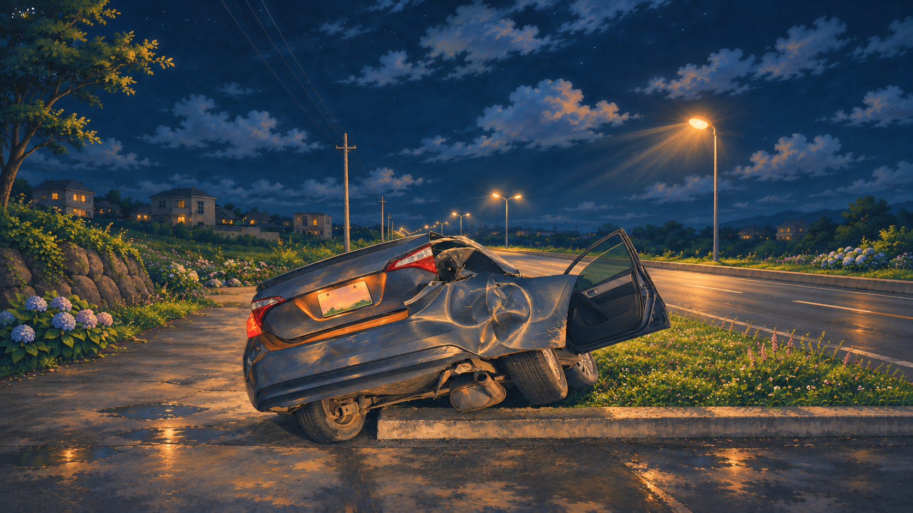

We haven’t had electricity for three days. This has made me spend less time looking at blue screens and more time writing and reading.

With a pen in my hand, I find myself thinking about a day early last year that started well and quickly became one of the most difficult days of my life.

Some guys were driving like they were in *Fast & Furious*. They hit my car from behind with so much force that they almost took my life. The impact damaged my car almost beyond repair.

I was clearly hit from behind, so there was very little to argue about regarding who caused the accident. Still, one of the guys got out of his car angry and almost beat me up. Nigeria has a way of protecting bullies. Somehow, after surviving the accident, I also had to defend myself against the people who caused it.

Then came the hospital visits, the police case and the cost of repairing the car.

It was not the money I wanted to spend, but it was money I had, and I’m grateful for that. I can hold both feelings at once. I can wish the accident had never taken that money from me while still being thankful that I had enough to handle what happened.

When I think about how I was able to survive that period, I think about the work it took to earn that money. I also think about where my ability to work so hard came from.

I worked even harder when I was younger. I built resilience and discipline early by following my father to the farm and doing hard manual labour. At the time, I probably didn’t understand what those experiences were building inside me. I only knew that there was work to be done.

The main thing that has changed is how smartly I can work and how much money that work can earn. The discipline is the same. The resilience is the same. They have simply found a different expression.

I’m learning how to bounce back from shock with less surprise each time. Sometimes bouncing back requires money you had planned to spend on something else. Sometimes it means going to the hospital and then finding the strength to deal with the police when all you want to do is go home. Sometimes it means accepting that life can change suddenly and still deciding to move forward.

This feels like a good time to start building resilience. Life will test you in ways you cannot predict. It may take your time, your peace, your plans or the money you worked hard to earn.

Many people may come save you, but your biggest saviour is you.
